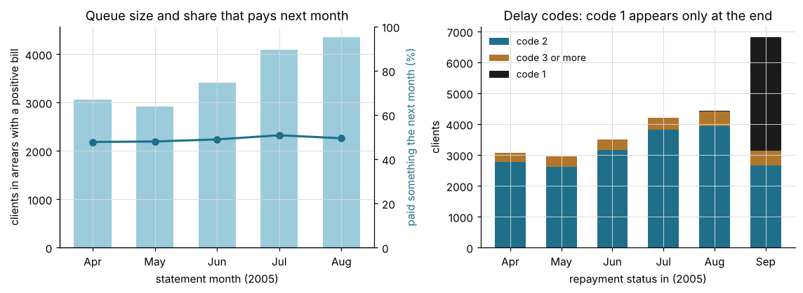
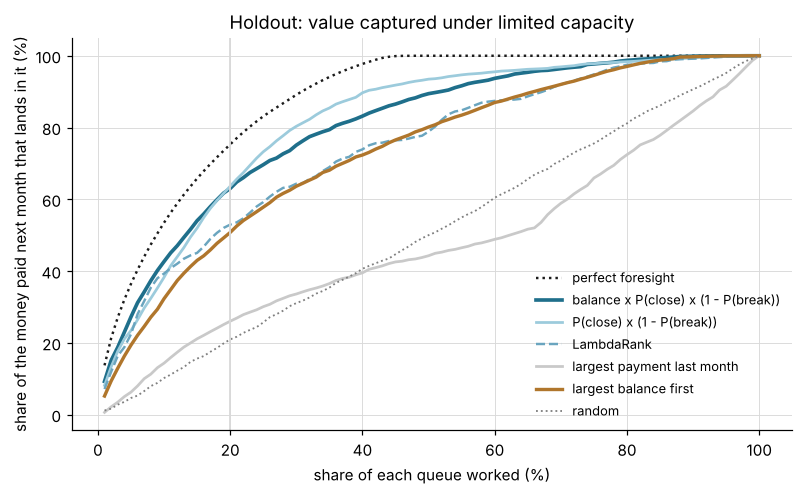
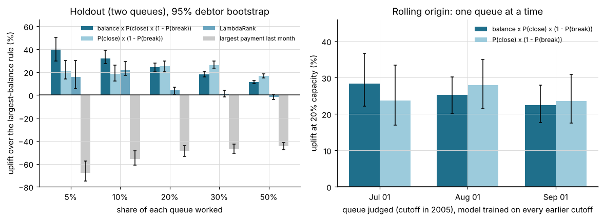
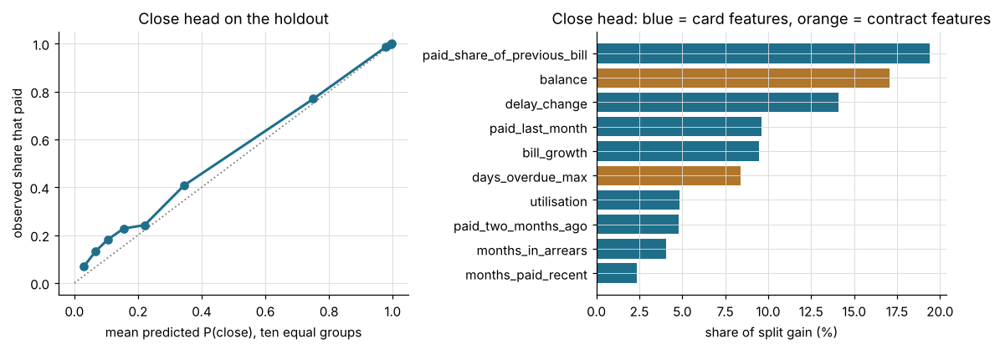

# Evaluation on a public credit-card dataset

Everything else in this repository runs on generated data, so every metric elsewhere describes the
generator. This page records one run of the training and evaluation stages on real credit-card data
that anyone can download. It says what the data lets the run test, what it cannot, and how little of
the result is a statement about collections.

## The data

The UCI Machine Learning Repository publishes "Default of Credit Card Clients", donated by I-Cheng
Yeh in 2016 under CC BY 4.0 (<https://archive.ics.uci.edu/dataset/350/default+of+credit+card+clients>,
DOI 10.24432/C55S3H). It follows 30,000 credit-card clients of a bank in Taiwan from April to
September 2005. For each client and month it has a repayment status, the bill statement and the
amount paid. For each client it has the credit limit, sex, education, marital status, age, and a flag
for whether the client defaulted in October.

Citation, as the repository asks: Yeh, I. (2009). Default of Credit Card Clients [Dataset]. UCI
Machine Learning Repository. <https://doi.org/10.24432/C55S3H>. The study behind it is Yeh, I. C. and
Lien, C. H. (2009), "The comparisons of data mining techniques for the predictive accuracy of
probability of default of credit card clients", Expert Systems with Applications 36(2), 2473-2480.
Nothing here implies that the authors or the repository endorse this work.

This repository does not contain the data. `collection_queue_ranker.uci_credit_card.fetch` downloads
`https://archive.ics.uci.edu/static/public/350/data.csv` (2.9 MB) and checks its SHA-256 before it
writes anything:

```
45bcf4df62ff2e237a74eb155cabfb4bbbc171219a0637daef44fdad07503dd0
```

The values are the ones in the Excel file inside the UCI zip (zip SHA-256
`56c885f84457f6680f8438f02bfcdac9579323d8a94465ee5f26e32baa727602`); I compared the two cell by
cell once. Both were checked on 2026-10-13.

| Check on the file | Result |
|---|---|
| Clients | 30,000, IDs 1 to 30,000, none repeated |
| Missing or non-numeric cells | none |
| Negative payments | none |
| Negative bill statements | 3,932 of 180,000 cells (credit balances) |
| Repayment status | -2 to 8; the source describes -1 to 9 |
| Clients in arrears at the five cutoffs (status of 1 or more) | 3,079, 2,968, 3,510, 4,213, 4,438 |
| ...of them with a bill of zero or less, left out | 22, 52, 96, 125, 84 |
| Rows in the five snapshots | 17,829 for 7,622 clients; 4,200 of them are in more than one |

### The delay codes do not behave like months overdue

The source says a status of 1 is a delay of one month, 2 is two months, and so on. In the file the
code 1 is almost absent until the last month: 0, 0, 2, 4 and 28 clients from April to August, and
3,688 in September. The code 2 is the usual delay (2,626 to 3,927 clients a month). From one month
to the next, 717 to 1,218 clients go from 0 straight to 2, 573 to 837 go from 2 back to 0, and only
131 to 290 go from 2 to 3 (April to August). Into September nobody goes from 2 to 0, and 3,688
clients appear with the code 1. A count of months overdue would not move like that. The package
takes the codes as given: a client is in arrears at a statement when its status is 1 or more, and days overdue is 30
times the status. The September status is never used, because every label comes from an amount
paid, and amounts look steady: between 47.8% and 50.8% of the clients in arrears pay something in
the following month at every cutoff.



Sex, education, marital status and age are not used. The package scores how a debtor responded, not
who the debtor is, and whether a queue may be ordered by those attributes is a decision for the
owner of the queue, not a default of a demo. The October default flag is not used either: it has no
amount attached.

## How the panel becomes a queue

The panel has no contact history, no agreements and no installments, so it cannot go through the
ten tables of the data contract. `uci_credit_card.build_datasets` writes the three files that
`cqr build-dataset` writes (`snapshots.csv`, `break.csv`, `dataset_meta.json`), and `cqr train` and
`cqr backtest` then run on them. The mapping:

| In the package | In this panel |
|---|---|
| Debtor | A client in arrears at a cutoff: status of 1 or more and a positive bill. A client can be in several snapshots, as a repeat debtor is |
| Cutoff | The first day of the month after a statement: 1 May to 1 September 2005. The September statement has no following month to label |
| `balance` | The bill statement of the month |
| `days_overdue_max`, `days_overdue_min` | 30 times the repayment status, the same value; `overdue_spread` is 0 |
| Close label | The client paid something in the next month. A stand-in for "signed an agreement", not the same event |
| Realised value | The amount paid in the next month, in NT dollars |
| Break label | The client paid in the next month and paid nothing the month after: the nearest thing to a missed second installment. One row per client, at the first month it paid, for cutoffs through 1 August |
| Contact, phone and e-mail features | The values the package gives a debtor with no history: counts of 0, a missing answer rate, a contact factor of 0.4 (the floor) for everyone |
| Product line | `card` |

Ten more features describe the card. They are listed in `features.extra_numeric`, which is the
package's way to add columns to a snapshot. Each uses only the statement month and the months before
it. Call `m` the statement month:

| Feature | Definition |
|---|---|
| `credit_limit` | The credit limit |
| `utilisation` | The bill of `m` divided by the credit limit |
| `paid_last_month` | The amount paid during `m` |
| `paid_share_of_previous_bill` | The amount paid in `m` divided by the bill of `m - 1`; missing when that bill is zero or less, or `m` is April |
| `paid_two_months_ago` | The amount paid in `m - 1`; missing for April |
| `months_paid_recent` | Months with a payment among `m - 2` to `m` |
| `months_in_arrears` | Consecutive months up to `m` with a status of 1 or more |
| `worst_delay_history` | The highest status from April to `m` |
| `bill_growth` | The bill of `m` minus the bill of `m - 1`, divided by the bill of `m - 1`; missing as above |
| `delay_change` | The status of `m` minus the status of `m - 1`; missing for April |

The settings are the package defaults plus these. Monthly cutoffs make the label window one month
and the break window two. The development side has three cutoffs, so two walk-forward folds is the
most it can make. The bootstrap is larger than the default only to tighten the intervals.

```json
{
  "labels": {
    "horizon_days": 30,
    "break_observation_days": 60
  },
  "features": {
    "extra_numeric": [
      "credit_limit",
      "utilisation",
      "paid_last_month",
      "paid_share_of_previous_bill",
      "paid_two_months_ago",
      "months_paid_recent",
      "months_in_arrears",
      "worst_delay_history",
      "bill_growth",
      "delay_change"
    ]
  },
  "split": {
    "cv_folds": 2
  },
  "evaluation": {
    "n_bootstrap": 1000
  }
}
```

### What runs and what does not

| Stage | On this panel |
|---|---|
| SQL adapters, the contract, agreement rules, `features_at`, `cqr build-dataset` | Not run. The adapter replaces them |
| Split on dates with a purge | Run |
| Parameter selection by walk-forward value capture | Run: three candidates, two folds |
| Close head, break head, LambdaRank | Run |
| Holdout report: AUC with a bootstrap interval, precision and lift, backtest per queue against the two baselines with a debtor-level bootstrap, verdict | Run |
| Contact-response features, phone quality, cooldown, tiers, collector lists (`cqr queue`) | Not exercised: there is nothing to score them on |
| `cqr monitor`, `diagnose`, `experiment`, `serve` | Not run |

The report keeps the package's headings, "P(agreement within horizon)" and "P(agreement breaks)".
Here they mean a payment and a missed second payment.

## Protocol

- Five cutoffs, 17,829 rows. Development: 1 May, 1 June and 1 July (9,387 rows). Holdout, the last
  30% cut on a date: 1 August and 1 September (8,442 rows). Nothing is purged, because every
  development label window ends before the boundary.
- The close head's parameters are chosen among the package's three candidates by the share of
  value captured at 20% capacity in two walk-forward folds on development rows. The winner has a
  depth of 6 and 31 leaves.
- The judge is the money paid in the next month. Capacity is applied inside each of the two queues
  and then summed. The break head has 2,182 development rows and 840 holdout rows.
- The headline is the package's default ordering, `ev_contact` (balance x P(close) x (1 -
  P(break)) x contact factor, where the contact factor is the same for everyone), at 20%
  capacity, against the largest-balance rule, with a 1,000-draw bootstrap that resamples clients.
- The label definitions, the ten features and the settings were written before the first training
  run, and the first run produced the headline below. After it I changed the bootstrap size (200 to
  1,000) and added what the result called for, because an AUC of 0.91 looked too good: reference
  orderings and a ceiling, a rolling origin, ablations, a check on how the AUC fades with the
  label horizon, five seeds and a stricter population. Nothing else changed.

## Results

### Headline

At 20% of each queue, the share of the next month's payments that lands in the worked rows:

| Ordering | Share of money | Uplift over the largest balance (95% interval) |
|---|---|---|
| Perfect foresight (the ceiling) | 75.3% | +48.3% (42.9 to 53.8) |
| balance x P(close) x (1 - P(break)), the package default | 63.0% | +24.1% (20.3 to 28.0) |
| P(close) x (1 - P(break)) | 63.6% | +25.4% (20.4 to 29.7) |
| balance x P(close) | 63.1% | +24.3% (20.4 to 28.4) |
| LambdaRank | 52.9% | +4.3% (0.5 to 7.0) |
| Largest balance first | 50.8% | |
| Largest payment last month | 26.0% | -48.7% (-53.4 to -44.2) |
| Random | 21.0% | -58.7% |

The package's verdict for the headline is "evidence of value: worth a controlled pilot". The default
ordering gets 84% of what perfect foresight gets; the balance rule gets 67%. By capacity:

| Capacity | Perfect foresight | Default ordering | Largest balance | Random | Default over largest balance |
|---|---|---|---|---|---|
| 5% | 36.4% | 27.2% | 19.4% | 4.6% | +40.7% (29.9 to 50.3) |
| 10% | 53.5% | 42.7% | 32.3% | 10.2% | +32.0% (27.4 to 39.1) |
| 20% | 75.3% | 63.0% | 50.8% | 21.0% | +24.1% (20.3 to 28.0) |
| 30% | 89.1% | 75.1% | 63.6% | 31.1% | +18.0% (15.9 to 20.9) |
| 50% | 100.0% | 89.4% | 80.1% | 50.0% | +11.6% (10.2 to 12.9) |



The close head has an AUC of 0.909 (interval 0.903 to 0.916) on the holdout, a base rate of 50.1%
and a precision of 1.00 in the top fifth. It predicts 46.4% on average where 50.1% paid. The
package prints "weak but real signal" for any interval above chance, whatever the AUC. The break
head has an AUC of 0.514 (0.474 to 0.555), which is chance, and predicts 44.5% where 26.2% broke.

### Across months

One queue at a time, each time trained on every earlier cutoff (so the first row has two
development cutoffs), at 20% capacity:

| Queue judged | Dev cutoffs | Rows | Close AUC | Default ordering | Largest balance | Uplift (95% interval) | P(close) x (1 - P(break)) | LambdaRank | Ceiling |
|---|---|---|---|---|---|---|---|---|---|
| 1 July | 2 | 3,414 | 0.925 | 65.9% | 51.4% | +28.3% (22.1 to 36.7) | +23.7% | -5.8% | 77.1% |
| 1 August | 3 | 4,088 | 0.912 | 62.3% | 49.8% | +25.2% (20.2 to 30.2) | +27.9% | +3.5% | 75.7% |
| 1 September | 4 | 4,354 | 0.928 | 63.2% | 51.6% | +22.4% (17.6 to 28.0) | +23.6% | +8.4% | 75.0% |

Five LightGBM seeds on the main split give +23.7% to +24.3% for the default ordering and +25.4% to
+26.8% for P(close) x (1 - P(break)). LambdaRank gives +0.1% to +4.5%: it is the one result that
moves with the seed.



### Where the gain comes from

| Features | Close AUC | Default ordering | Largest balance | Uplift (95% interval) | Verdict |
|---|---|---|---|---|---|
| The ten card features and the contract's own (main run) | 0.909 | 63.0% | 50.8% | +24.1% (20.3 to 28.0) | evidence of value |
| Only the contract's own: balance and days overdue | 0.693 | 51.3% | 50.8% | +1.1% (-1.3 to 2.6) | little or no gain |

With the features the contract provides, the model does not beat the balance rule on this panel.
Everything comes from the ten added features. Adding one group to balance and days overdue, with
no interval computed:

| Group added | Features | Close AUC | Default ordering | P(close) x (1 - P(break)) | LambdaRank |
|---|---|---|---|---|---|
| Payments | `paid_last_month`, `paid_two_months_ago`, `months_paid_recent`, `paid_share_of_previous_bill` | 0.838 | +12.3% | +10.2% | -1.3% |
| Bill | `credit_limit`, `utilisation`, `bill_growth` | 0.814 | +6.1% | +0.9% | +0.2% |
| Delay history | `months_in_arrears`, `worst_delay_history`, `delay_change` | 0.840 | +17.9% | +16.0% | +14.1% |

No group carries it alone: each one added to balance and days overdue gets an AUC of 0.81 to 0.84,
and all ten together 0.91. The close head's most used features are `paid_share_of_previous_bill` (19% of the split gain), `balance` (17%), `delay_change` (14%),
`paid_last_month` (10%) and `bill_growth` (9%).



### Does the signal fade with distance?

An AUC of 0.91 on a "will they pay" label is high, so I checked whether it is a one-step artefact.
The label becomes "paid something `h` months after the cutoff", with the same features and the
default LightGBM parameters, trained on the earlier cutoffs and judged on the last ones. There is no
purge, which can only flatter the longer horizons, because their label windows overlap the test
queue.

| Months ahead | Cutoffs for training and testing | Test rows | Share that pays | AUC |
|---|---|---|---|---|
| 1 | 3 and 2 | 8,442 | 50.1% | 0.907 |
| 2 | 3 and 1 | 4,088 | 75.9% | 0.796 |
| 3 | 2 and 1 | 3,414 | 72.5% | 0.692 |

It fades. That is what persistent behaviour looks like and it is not what a leak of the next
month's payment into the features would look like. It is not proof, because the dates in the file
are months: nothing orders a payment against the statement inside a month.

### A stricter population

The same stages on clients with a status of 2 or more for at least two months running (9,876 rows,
4 cutoffs, 63% pay next month, two development cutoffs and so one walk-forward fold):

| Ordering | Share of money at 20% | Uplift over the largest balance (95% interval) |
|---|---|---|
| Perfect foresight | 63.6% | |
| balance x P(close) x (1 - P(break)) | 56.1% | +12.1% (9.3 to 15.1) |
| P(close) x (1 - P(break)) | 48.4% | -3.3% (-7.4 to 1.1) |
| LambdaRank | 49.8% | -0.6% (-3.2 to 1.6) |
| Largest balance first | 50.1% | |

The close AUC is 0.946 and the break AUC 0.530. The gain is half the size, and ordering by
probability alone no longer works. Who is in the queue changes the answer.

## Reading the results

- The stages run on real data and produce an interval. The verdict is not always yes: it says
  "little or no gain" for the model that only sees the contract's own debt features, and the gain
  halves on a stricter population.
- On this panel the model beats the balance rule because of how the card behaves: the changes in
  the delay code, the payments and the bill. None of that exists in the contract's debt features.
- The break head learns nothing here. It sees balance and days overdue only, and its AUC is 0.51.
  Dropping it changes nothing (+24.3% without it, +24.1% with it).
- Multiplying by the balance pays at small capacities (+40.7% against +21.0% for probability alone
  at 5%) and does not from 20% up. Payments are small next to balances: a row has a mean of NT$1,645
  paid next month against a mean balance of about NT$50,000.
- The rule an analyst would try first, work whoever paid the most last month, is close to random
  (26.0% against 21.0%). Whoever paid last month is less likely to pay this month in this panel:
  42% against 64% for those who did not.
- LambdaRank is not reliable here. It ranges from -5.8% to +8.4% across months and from +0.1% to
  +4.5% across seeds. The expected-value orderings are the ones to read.

## What this does not show

- It is not collections. The clients are card holders of one bank in 2005, the arrears are
  repayment statuses of a revolving card, and nobody called anyone. There are no contacts, no
  agreements and no installments, so the response features, the cooldown, the phone gate and the
  queue rules did not run.
- The event is a payment, not an agreement. This panel's payments follow the rhythm of a card's
  billing cycle, which may make "pays next month" much easier to predict than "signs an agreement".
  An AUC of 0.91 here says nothing about the AUC to expect on agreements.
- The backtest asks who pays, not whom a call would move. The money counted would mostly have been
  paid without any call. Only a controlled pilot can test the effect, as the README says.
- The delay codes are not months overdue (see above), so "days overdue" here is a rescaled code.
- Six months, two holdout queues, one issuer. The intervals resample clients; they do not cover
  the choice of this panel, of these months or of these definitions.
- The numbers belong to this file, this protocol and these library versions. The run is
  deterministic on one platform and library set: Python 3.13.16, numpy 2.4.6, pandas 2.3.3,
  scikit-learn 1.9.1 and lightgbm 4.7.0 on Linux. It has not been run on Windows or Python 3.14,
  and CI never downloads the file.

## Reproduce

```bash
pip install -e ".[dev,realdata]"
python scripts/evaluate_uci_credit_card.py --data data --out artifacts/uci_credit_card --figures docs/img
```

The first run downloads the file and checks its hash; `data/` and `artifacts/` are ignored by git.
The run takes about five minutes on a four-core machine (313 seconds here). It leaves the three
dataset files, `settings.json` and the package's reports in `artifacts/uci_credit_card/`, and a
`summary.json` with every number on this page. The same files go through the package commands:

```bash
cqr train --artifacts artifacts/uci_credit_card --config artifacts/uci_credit_card/settings.json --no-tracking
cqr backtest --artifacts artifacts/uci_credit_card --config artifacts/uci_credit_card/settings.json --no-tracking
```

`cqr train` writes the same `metrics.json` as the script; I compared the two files.
